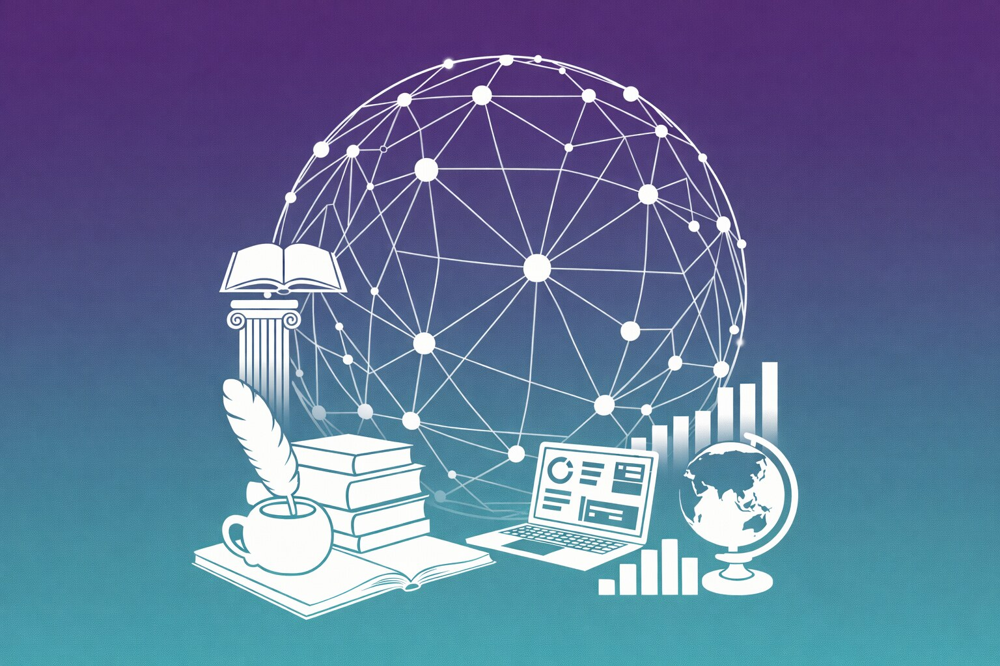

{.img-right width=300 fig-alt="Illustration: a network of connected points arching over symbols of scholarship (open books, a quill, a classical column, a globe) and of computing (a laptop and bar charts)."}

These materials introduce researchers in the humanities and social sciences to how contemporary AI systems work, what they can and cannot do, and how to use them critically in research. They start from a single idea: AI models learn patterns from data, and both their usefulness and their characteristic failures follow from it.

The three units move from concepts to practice to method. Unit 1 explains how models learn, and why large language models (LLMs) produce fluent text that can be confidently wrong. Unit 2 turns to working with LLMs: prompting them well, judging how far to trust their output, and documenting and acknowledging their use. Unit 3 builds a Python pipeline that extracts names from historical letters, and evaluates it against human annotations. Throughout, the question is not only whether a tool gives a good answer, but whether you could check it, repeat it, and report it.

The materials are designed for self-study and no technical background is assumed. The first two units need no programming, and the third asks you to read and run code, not to write it.

::: {.callout-note}
## The Running Example

Robert Louis Stevenson (1850–1894), the author of *Treasure Island* and *Strange Case of Dr Jekyll and Mr Hyde*, was a prolific letter writer. A collection of 462 of his letters, written between 1863 and 1894, is used as an example dataset in all three units: you'll question them with a chat assistant, explore them with an AI research tool, and analyze them with a Python pipeline. [More about the letters.](reference/letters.qmd)
:::

## The Three Units

### [Unit 1: Key Concepts](unit_1/index.qmd)

Unit 1 covers what AI systems are, how they learn from data, and why they behave the way they do. You'll train a small model yourself with Teachable Machine, and try to talk a chatbot out of its secret password in Hack Merlin.

### [Unit 2: Working with LLMs](unit_2/index.qmd)

Unit 2 covers how large language models process your prompts, how to prompt them well, how to judge how far their output can be trusted, and how to be transparent about using them. You'll explore a set of historical letters with an AI research tool, and find out what it does well, and what it can’t do reliably.

### [Unit 3: Programmatic Approaches](unit_3/index.qmd)

Unit 3 covers what to do when you need scale, structured data, and reproducible results. You'll run a pre-trained model over 462 letters, turn the results into charts, a network, a timeline, and a map, and then measure how accurate the results actually are when compared to annotations made by people, including your own.

## Using These Materials

- **Work through the units in order.** Each builds on the one before. Within a unit, follow the pages in the order shown in the menu.
- **Do the activities.** They're where most of the learning happens. Each one tells you how long it takes and what you need.
- **Before Unit 3,** [set up Python](unit_3/python_setup.qmd) (the quickest option runs in your browser, with nothing to install). If you're new to Python, work through the first two units of this [self-paced introduction to Python](https://github.com/gpizzorno/introduction-to-python). You'll need to read and run code, not write it from scratch.
- **Look up unfamiliar terms** in the [Glossary](reference/glossary.qmd). Each entry gives a short definition, and links to the page that explains the term in full.

::: {.callout-warning}
## About Citations

The pages in this website follow standard academic practice and cite their sources. Most of them, however, are research papers written for specialists, and reading them is not necessary to follow the materials. If you do open one, the abstract and introduction usually make the main point without the technical detail. Many of the pages include **Going Further** boxes that list readings chosen for non-specialists.
:::

## Requirements

- **Units 1 and 2:** a web browser, a webcam or microphone (for Teachable Machine), a Google account, and access to a general-purpose AI chat assistant such as *ChatGPT*, *Claude*, or *Gemini* (free versions are fine).
- **Unit 3:** Google Colab (free, in your browser) or Python installed on your computer.

## About

These materials grew out of in-person workshops and have been adapted for self-study. Everything, including the notebook and data, is also available in the [GitHub repository](https://github.com/gpizzorno/understanding-ai). For details, see [About These Materials](about.qmd).
