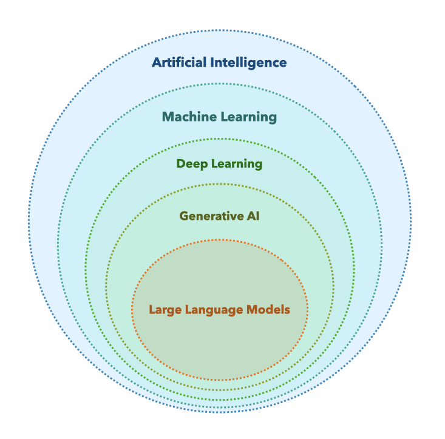
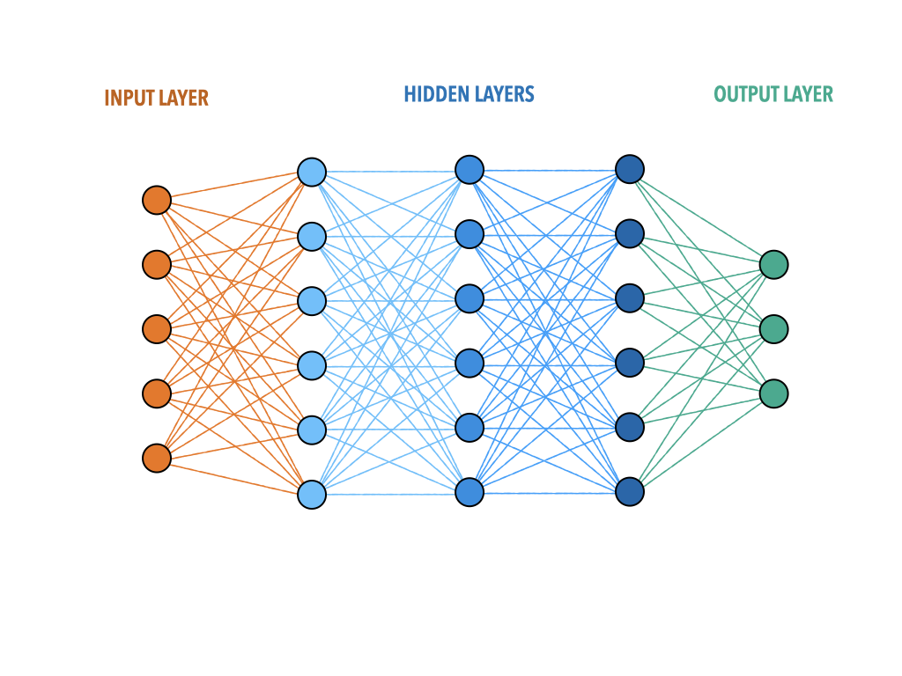
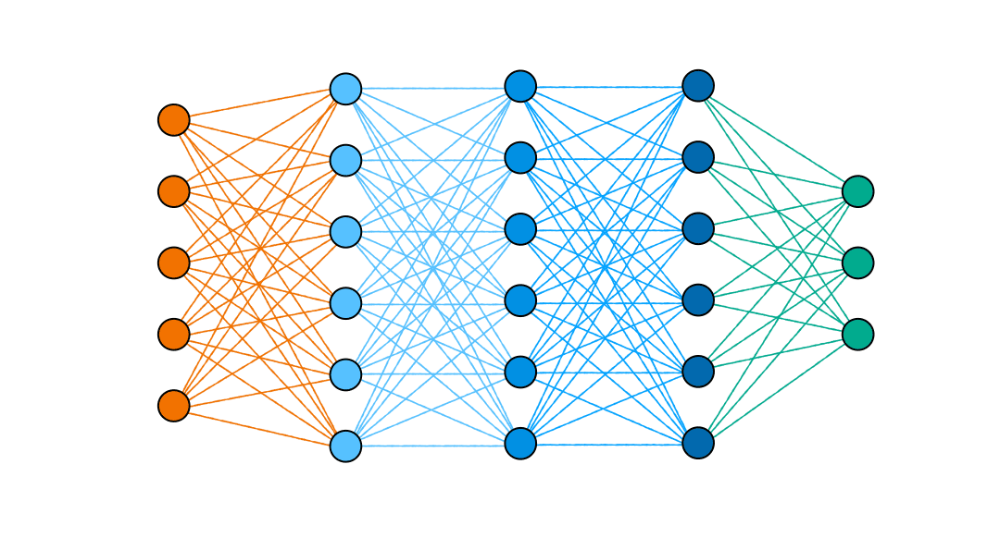
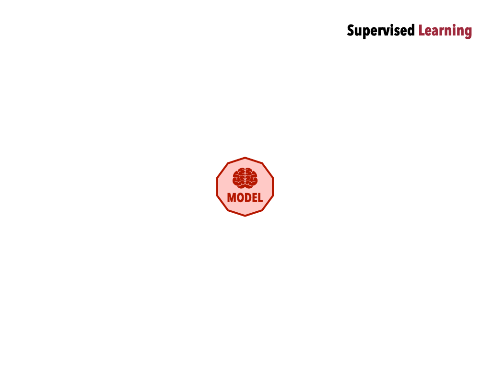
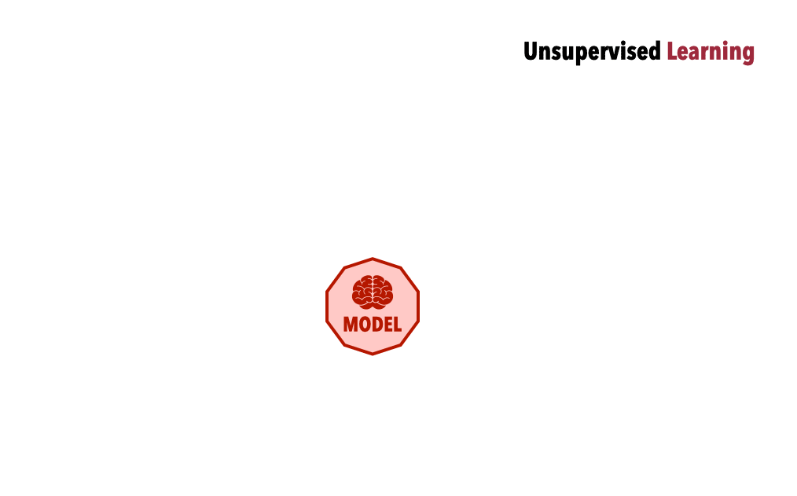

Artificial intelligence, large language models, and machine learning are reshaping research across disciplines, including the humanities and social sciences. Understanding how they work, even at a high level, makes you a more critical user and a stronger evaluator of AI-assisted research.

This page gives you a working vocabulary and a mental model of how these systems learn from data. Everything else in these materials (capabilities, failures, bias, evaluation) builds on it. [Language Models](language_models.qmd), later in this unit, looks at how the systems behind chat assistants turn this into text.

## Terminology

Terminology in this area is genuinely confusing. The same words mean different things to different people, and press coverage uses *AI* for everything from a voice assistant, to a self-driving car, to a hypothetical sentient machine. The terms below are nested, from broadest to narrowest.

{.img-right width=400}

**Artificial Intelligence (AI)** is the broadest term: a field with the ambition of building systems that perform tasks we would call *intelligent* if a human did them. It covers chess engines, spam filters, image recognition, and language generation. The term has been in use since the 1950s and carries a lot of historical baggage and hype. It is useful as a category label, but too broad to tell you much about how any specific system works.

**Machine Learning (ML)** is a subfield of AI in which systems learn patterns from data rather than following hand-coded rules. It is the dominant approach in modern AI. When people talk about *training* a model, they mean a machine learning process. Nearly everything in these materials falls under ML.

**Deep Learning (DL)** is a subfield of ML that uses neural networks with many layers (hence *deep*). It is behind most of the striking AI capabilities of the past decade: image recognition, speech recognition, translation, and language generation. It requires large amounts of data and computing power, which is one reason AI advanced so quickly as both became cheaper.

**Generative AI** is the category of systems that produce new content (text, images, audio, video, code) rather than only classifying or predicting. It is the term most used in public discussion right now, but it groups together systems with very different designs and behaviours: image generators such as Stable Diffusion or DALL-E are generative AI, and so are LLMs.

**Large Language Models (LLMs)** are deep learning models trained on massive collections of text: a large fraction of the publicly accessible web, plus books, code, and other sources. They learn statistical patterns in language at enormous scale, which lets them generate coherent, contextually appropriate text. ChatGPT, Claude, Gemini, and Llama are built on LLMs.

Why is *AI* used as a catch-all? Largely for marketing: *machine learning model* is accurate, but it doesn't sell products or generate headlines. Noticing this is itself a useful habit when reading coverage of AI.

## From Rules to Examples

At the heart of all these terms is one idea: that machines can learn, in a sense, the way people do, from examples. This is the key conceptual shift from traditional computing.

In ordinary software, a programmer writes rules: `if the input contains the word 'cat', classify it as an animal`. The program does exactly what it was told. It doesn't learn, adapt, or improve.

In machine learning, no one writes those rules. The system infers them from examples: the rules are derived from data. This is a fundamental shift. To get a system to do what you want, *you don't write logic, you curate examples*.

Take a task you'll return to in [Unit 3](../unit_3/index.qmd): finding the people mentioned in [Robert Louis Stevenson's letters](../reference/letters.qmd). With rules, you might write `a capitalized word after 'Mr.' or 'Dear' is a person`, and you'd immediately drown in exceptions, *e.g.*, `Dear Sir`, `MY DEAR COLVIN`. With machine learning, people instead mark every name in thousands of example sentences, and the system works out for itself what names tend to look like. That is how the model you'll use in Unit 3 was made.

How a system actually learns from its examples is the subject of [Model Training](model_training.qmd). But first, *what kind of system* does the learning?

## Neural Networks and Weights

{.img-right width=500}

The most common learning architecture is a [neural network](https://en.wikipedia.org/wiki/Neural_network_(machine_learning)), a mathematical structure loosely inspired by the brain.

- A network is made of simple units called [artificial neurons](https://en.wikipedia.org/wiki/Artificial_neuron), connected to each other.
- Neurons are organized in *layers*. Data enters at the *input layer*, passes through one or more [hidden layers](https://en.wikipedia.org/wiki/Hidden_layer) that transform it, and emerges at the *output layer*.
- Each connection has a *weight*: a number that determines how the value passing along it changes.
- A network with many hidden layers is called a [*deep* neural network](https://en.wikipedia.org/wiki/Deep_learning#Deep_neural_networks), which is where *deep learning* gets its name.

The weights are the key to everything, so it's worth following some values through a network:

{width=949}

Two values, `1` and `2`, enter at the *input layer*. Each connection multiplies the value passing along it by the connection's weight, and each neuron adds up everything that arrives:

- The second neuron in the first hidden layer receives only the `2`, along a connection with a weight of `2`: `2 × 2 = 4`.
- The neuron above it receives both inputs: `1 × 1 + 2 × 3 = 7`.
- The next layer does the same with those results: `7 × 2 + 4 × 3 = 26`, then `26 × 1 = 26`.
- Finally, `26 × 2 = 52` arrives at the *output layer*.

The animation follows only a few connections. In a real network, every neuron combines the values arriving along *all* its connections, and passes the result through a simple function (the [activation function](https://en.wikipedia.org/wiki/Activation_function)) that lets the network represent complex patterns. But the principle is the same: *what comes out depends entirely on the weights*. Change any one of them, and the `52` changes too.

And the weights are what the network *learns*. Before training, they are random, so the output is meaningless. Training nudges each weight up or down, very slightly, over and over, until the network's outputs come out right for its training examples. A small network like the one in the animation has a few dozen weights, a modern LLM has billions. Everything a network “knows” is stored in those numbers, and nowhere else.

Different kinds of networks suit different kinds of data. [Convolutional networks](https://en.wikipedia.org/wiki/Convolutional_neural_network) were long the standard for images. [Recurrent networks](https://en.wikipedia.org/wiki/Recurrent_neural_network) process sequences one step at a time and were the standard for text until the late 2010s. [Transformers](https://en.wikipedia.org/wiki/Transformer_(deep_learning)), described below, have since replaced them for language and are increasingly used for images and audio too.

## Types of Machine Learning

There are several basic ways to train a model. They differ in what the model learns *from*.

### Supervised Learning

{.img-right width=320}

The model learns from examples that come with the correct answer: inputs paired with *labels*. Think of teaching with an answer key. To build a model that finds names in text, people annotate thousands of sentences, marking every name and whether it's a person, a place, or an organization; the model learns patterns that predict those labels, and can then label new text it has never seen. The [named entity recognition (NER)](https://en.wikipedia.org/wiki/Named-entity_recognition) models in [Unit 3](../unit_3/index.qmd) were trained this way.

### Unsupervised Learning

{.img-right width=300}

There is no answer key. The model looks for structure in the data on its own and groups similar items together. Given all 462 of Stevenson's letters, unlabelled, it might group them into clusters that turn out to correspond to correspondents, periods, or topics, or to something nobody expected. It is more a tool for exploring and discovering patterns than for confirming known ones, and it's up to you to work out what the groups mean.

### Semi-Supervised Learning

This approach combines a small amount of labelled data with a large amount of unlabelled data. It is useful when labelling is expensive or slow, as it often is for historical and archival material.

### Reinforcement Learning

{.img-right width=300}

The model learns by trial and error: it produces outputs, and each one is scored, rewarded or penalized, and the model adjusts to earn more reward. Think of training a dog: no answer key, just rewards for good behaviour. A version called [reinforcement learning from human feedback (RLHF)](https://en.wikipedia.org/wiki/Reinforcement_learning_from_human_feedback) is a key technique for shaping LLMs: people rate model outputs, and the model is tuned towards the kinds of answers they prefer. Much of the behaviour of chat assistants comes from this stage. So do their refusals, which, as the [Hack Merlin activity](hack_merlin.qmd) shows, are learned patterns rather than hard rules.

## Key Takeaways

- *AI* is a broad umbrella. Machine learning, deep learning, generative AI, and LLMs are progressively narrower parts of it, and knowing which one you're dealing with tells you much more about how a tool behaves.
- Machine learning systems aren't given rules: they derive patterns from examples. To get a model to do what you want, you curate examples, and what's in them shapes everything the model does.
- A neural network's output depends entirely on its weights, and the weights are what it learns. Everything it *knows* is stored in those numbers.
- Models can learn from labelled examples (supervised), from unlabelled data (unsupervised), or from rewards (reinforcement learning). Chat assistants' helpfulness and their refusals both come from training on human feedback.

## Next Steps

Try [Teachable Machine](teachable_machine.qmd): you will train a small model yourself, which mirrors on a tiny scale what happens inside much larger models. As you choose your categories and examples, think about what assumptions you are building in.
