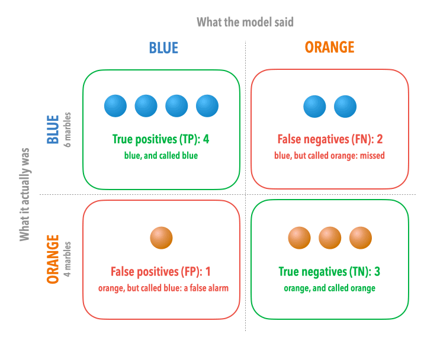

[Model Training](model_training.qmd#measuring-performance) introduced four ways to measure how well a model performs: **accuracy**, **precision**, **recall**, and **F1**. They're easier to grasp with actual numbers, so this page works through each one with a deliberately simple example. It's worth getting comfortable with them here: in Unit 3, you'll calculate the same measures for a model that finds names in Stevenson's letters, and decide how far to trust it based on them.

## Classification Example

Suppose you have a bag of **10 marbles**, **6 blue** and **4 orange**, and you train a machine learning model to classify each marble by colour. After training, you test the model on all 10 marbles and get the following results:

| | Model says: Blue | Model says: Orange |
|---|:-:|:-:|
| **Actually Blue** | **4** | 2 |
| **Actually Orange** | 1 | **3** |
: {.sm}

This table is called a **confusion matrix**. Here are the same results as marbles: each marble is its actual colour, placed in the column of what the model said it was. (Blue and Orange correspond to the positive and negative classes, respectively.)

{width=600}

Each cell tells you something specific:

- **4 blue marbles called Blue:** the model said Blue, and it was right. These are **true positives (TP)**.
- **2 blue marbles called Orange:** the model missed them; they were blue, but it predicted Orange. These are **false negatives (FN)**.
- **1 orange marble called Blue:** the model made a mistake; it was orange, but it predicted Blue. This is a **false positive (FP)**.
- **3 orange marbles called Orange:** the model said Orange, and it was right. These are **true negatives (TN)**.

It helps to keep the logic of the names straight: *true/false* tells you whether the model was correct; *positive/negative* tells you what the model predicted. Here, "positive" means "Blue": the class you're trying to find.

## Accuracy

**Accuracy** is the simplest metric: of all the marbles, what fraction did the model get right?

$$\text{Accuracy} = \frac{TP + TN}{\text{Total}} = \frac{4 + 3}{10} = \frac{7}{10} = 0.70$$

The model correctly classified 7 out of 10 marbles, giving an accuracy of **70%**.

Accuracy is intuitive, but it can be misleading. Imagine a bag with 9 blue marbles and 1 orange marble: a model that always guesses Blue would score 90% accuracy while completely failing to detect any orange marbles. When classes are imbalanced, accuracy alone doesn't tell the whole story.

## Precision

**Precision** asks: *of all the marbles the model called Blue, how many actually were blue?*

$$\text{Precision} = \frac{TP}{TP + FP} = \frac{4}{4 + 1} = \frac{4}{5} = 0.80$$

When the model predicted Blue, it was right **80%** of the time. Precision measures how trustworthy the model's positive predictions are. A low precision means lots of false alarms.

## Recall

**Recall** asks the opposite question: *of all the marbles that were actually blue, how many did the model find?*

$$\text{Recall} = \frac{TP}{TP + FN} = \frac{4}{4 + 2} = \frac{4}{6} \approx 0.667$$

The model found **4 of the 6** blue marbles, a recall of about **67%**. The other two blue marbles were missed (called Orange). Recall measures coverage: how many of the things you were looking for you actually caught. A low recall means the model is missing things.

### The Tradeoff: Precision vs. Recall {#precision-vs-recall-the-tradeoff}

Precision and recall are often in tension. Imagine the model becomes more conservative and only calls a marble Blue when it is very certain. This improves precision (fewer false alarms) but will likely lower recall (more blue marbles go undetected). Conversely, making the model more eager to predict Blue improves recall, but lets more orange marbles slip through as false positives.

Which matters more depends on the task. If you are collecting every blue marble and plan to check the results by hand anyway, **recall matters more**: better to have some false alarms than to miss real blue marbles. If the results go straight into further analysis without checking, **precision matters more**.

## F1 Score

The **F1 score** combines precision and recall into a single number. It is the *harmonic mean* of the two, a form of average that penalizes large imbalances between them:

$$F1 = 2 \times \frac{\text{Precision} \times \text{Recall}}{\text{Precision} + \text{Recall}} = 2 \times \frac{0.80 \times 0.667}{0.80 + 0.667} = 2 \times \frac{0.533}{1.467} \approx 0.727$$

The F1 score for our model is approximately **0.73** (or 73%). A perfect model would score 1.0; a model that gets everything wrong would score 0.

The harmonic mean is used rather than a simple average because it is sensitive to imbalance. A model with 100% precision and 0% recall would have an F1 of 0, correctly reflecting that it is useless, whereas a simple average would give it a misleadingly middling 50%.

## Summary

| Metric | Formula | Value | What it asks |
|-|---|-|---|
| **Accuracy** | (TP + TN) / Total | 0.70 | Overall, how often was the model right? |
| **Precision** | TP / (TP + FP) | 0.80 | When it said Blue, how often was it correct? |
| **Recall** | TP / (TP + FN) | 0.667 | Of all the blue marbles, how many did it find? |
| **F1 score** | 2 * (Precision * Recall) / (Precision + Recall) | 0.727 | Balance between precision and recall |
| **Recall** | TP / (TP + FN) | 0.67 | Of all the blue marbles, how many did it find? |
| **F1 score** | 2 × (P × R) / (P + R) | 0.73 | Balanced summary of precision and recall |
: {.sm}

All the metrics above are calculated with Blue as the *positive class*. In a real evaluation, you would often report metrics for each class separately, or an average across all classes. The core logic is the same: define what counts as a "positive" prediction, then count true positives, false positives, and false negatives from there.

## From Marbles to Letters

In Unit 3, the "marbles" are the names in [Stevenson's letters](../reference/letters.qmd), and the positive class is a type of name, such as *person*. A model reads each letter and marks the people it finds; people have annotated the same letters, and their annotations are treated as the correct answers:

- A **true positive** is a person the model marked who is also in the annotations, such as "Sidney Colvin".
- A **false positive** is something the model marked as a person that isn't one. In one letter, the model marks "Clever" (from "not so CLEVER perhaps") as a person.
- A **false negative** is a person the model missed. In the same letter, it misses "COLVIN" in "MY DEAR COLVIN".
- **True negatives** would be every other word in the letters, correctly left unmarked. There are so many of them that accuracy would be close to 100% for almost any model, which is why the evaluation in Unit 3 uses only precision, recall, and F1.

## Next

Continue with [Language Models](language_models.qmd), or go back to [Model Training](model_training.qmd#the-black-box-problem) if you jumped here from there.
