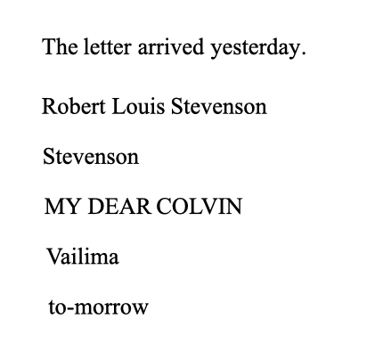
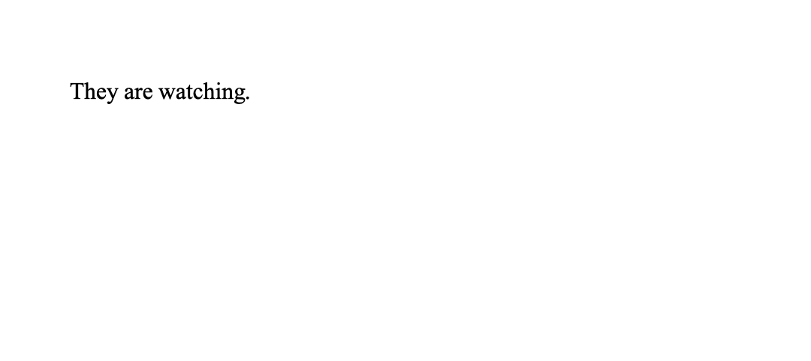

[Basic Concepts](basic_concepts.qmd) described how machine learning systems in general learn from examples. This page addresses the kind of system behind *ChatGPT*, *Claude*, and *Gemini*: the **language model**. It follows a piece of text through one such model: how it's broken into **tokens**, how tokens become numbers, how a **transformer** relates them to each other, and, finally, how the model produces text of its own. That last step explains much of what makes LLMs useful, and much of what makes them unreliable.

## Tokens

A language model processes text by breaking it into small pieces called [tokens](https://en.wikipedia.org/wiki/Large_language_model#Tokenization): whole words, parts of words, or punctuation. A common word is usually a single token, while a rare name or an unusual spelling may be split into several [@sennrichNeuralMachineTranslation2016; @jurafskySpeechLanguageProcessing2026, chap. 2].

{.img-right width=300 fig-alt="Animation: examples split into tokens by GPT-4o's tokenizer. “The letter arrived yesterday.”, “Robert Louis Stevenson”, and “Stevenson” come out as whole words. “MY DEAR COLVIN” splits into MY, DE, AR, COL, VIN; “Vailima” into V, ail, ima; and “to-morrow” into to, -m, orrow."}

The animation shows how the [tokenizer](https://github.com/openai/tiktoken) used by OpenAI's GPT-4o model splits some examples, most of them from [Stevenson's letters](../reference/letters.qmd). Common words, spaces included, are single tokens. Names, ALL-CAPS text, and old spellings are broken into fragments that often don't correspond to anything meaningful. The same text can even be split differently depending on what comes before it.

This can be seen even more clearly in the case of inflected and agglutinative languages (*i.e.,* languages that build long words out of many parts). Turkish *evlerimizden* (from our houses) happens to split along its meaningful parts: ev (house) ler (plural) imiz (our) den (from). Latin *laudavissemus* (we would have praised) doesn't: la ud avis sem us. The root *laud-* (praise) is cut in two, and one of the fragments, *avis*, just happens to be the Latin word for bird. Tokenizers are built from the statistics of their training text, which is mostly English, so text in other languages usually takes more tokens, and is split less meaningfully. That affects how well models handle those languages, and how much it costs to use them [@rustHowGoodYour2021; @petrovLanguageModelTokenizers2023; @ahiaAllLanguagesCost2023].

## Word Embeddings

You might be wondering: if a neural network works by adding and multiplying numbers along its connections (see [Neural Networks and Weights](basic_concepts.qmd#neural-networks-and-weights)), how can it do anything with *words*, or even tokens? It can't, at least not directly. Before a neural network can do anything with text, every token has to become numbers.

{width=949 fig-alt="Animation: the words wolf, dog, cat, banana, and apple go into an embedding model, and each comes out as a list of six numbers. The lists are then placed as points in a space, where wolf, dog, and cat sit close together, and banana and apple sit together elsewhere."}

That is what an *embedding* does. Each token (here: wolf, dog, cat, banana, apple) is turned into a list of numbers. The figure shows six numbers per word, real models use hundreds or thousands [@mikolovDistributedRepresentationsWords2013; @grattafioriLlama3Herd2024]. Each list places its word as a point in a space with that many dimensions, and in that space:

- **Words with related meanings end up close together.** Wolf, dog, and cat form one cluster, and banana and apple another.
- **Directions in the space can capture relationships.** For example, the difference between singular and plural, or between a country and its capital [@mikolovDistributedRepresentationsWords2013; @mikolovLinguisticRegularitiesContinuous2013; @jurafskySpeechLanguageProcessing2026, chap. 5].

Nobody decides these numbers by hand. They are learned during training, in exactly the same way as the weights, in fact, they *are* weights. A model ends up placing words close together when they occur in similar contexts, which is why the positions reflect meaning. It's also why they reflect the assumptions in the training text, as [Model Training](model_training.qmd#bias-in-training-data) showed.

Embeddings give models a way to work with meaning numerically, capturing subtle relationships among words, phrases, and concepts. Whether a language model understands language in any sense is debated, but it certainly doesn't understand it as a human does: **it builds a mathematical model of language patterns that can convincingly mimic understanding** [@benderClimbingNLUMeaning2020; @mitchellDebateUnderstandingAIs2023]. That makes it a powerful tool for exploring and generating text, but also one that needs careful checking.

## From Sequence to Sequence: Transformers

Many language tasks turn one sequence of tokens into another. The classic example is translation:

{width=600 fig-alt="Animation: “They are watching.” is split into tokens, which form the input sequence. An encoder–decoder turns it into an output sequence, which becomes the French “Ils regardent.”"}

They are watching. is split into tokens (They are watching .), which form the **input sequence**. An **encoder** reads the input sequence and turns it into an internal representation of its meaning (numbers, like everything else in a network). A **decoder** then uses that representation to produce the **output sequence**, one token at a time [@sutskeverSequenceSequenceLearning2014]: Ils regardent . The same design works for other tasks that turn one text into another, such as turning a question into an answer, or a long text into a summary.

What sits inside the encoder and decoder has changed over time, and each change addressed a weakness of the system that preceded it:

- [**Recurrent neural networks (RNNs)**](https://en.wikipedia.org/wiki/Recurrent_neural_network) read the input one token at a time, carrying a running summary forward from each token to the next. By the end of a long sentence, the beginning has largely faded from that summary, so RNNs struggled to connect words that were far apart.
- [**Long short-term memory (LSTM)**](https://en.wikipedia.org/wiki/Long_short-term_memory) networks added internal *gates* that decide, at each step, what to keep, what to forget, and what to pass on. They could carry information much further, and were the standard for translation in the mid-2010s. But they still processed text one token at a time, which made them slow to train on large amounts of text [@hochreiterLongShorttermMemory1997; @wuGooglesNeuralMachine2016; @jurafskySpeechLanguageProcessing2026, chap. 14].
- [**Transformers**](https://en.wikipedia.org/wiki/Transformer_(deep_learning)) (introduced in 2017) did away with step-by-step reading, and rely instead on a mechanism called *attention* (first used to help recurrent networks with translation), which lets the model weigh every token against every other token at once. This way, it can relate words and ideas regardless of how far apart they are, and it can process a whole passage in parallel, which made training on vast amounts of text practical. This is what makes modern models so much more coherent over long passages [@bahdanauNeuralMachineTranslation2015; @vaswaniAttentionAllYou2017a; @jurafskySpeechLanguageProcessing2026, chaps. 7, 13].

The original transformer kept the encoder–decoder design. Most of today's chat models use only the decoder half: they read everything (your prompt and their own output) and generate the next token, one at a time, each time going over the whole text. The *GPT* in *ChatGPT* stands for *Generative Pre-trained Transformer* [@radfordImprovingLanguageUnderstanding2018; @jurafskySpeechLanguageProcessing2026, chap. 7].

## Text Generation

Much of the behaviour of an LLM follows from its strategy for generating *the next token*. At each step, the model doesn't choose a single next token. It produces a *probability for every token in its vocabulary*: how likely each one is to come next, given everything so far. Here is a real example, from a small open language model ([Qwen2.5-0.5B](https://huggingface.co/Qwen/Qwen2.5-0.5B)), completing a sentence that could come from one of Stevenson's letters.

{width=700 fig-alt="Animation: the probabilities a small language model (Qwen2.5-0.5B) gives to the next word of “…and I hope to send it to you before the end of the ____”, at three temperatures. At 1.0: week 41%, month 28%, year 17%, day 4%, and semester, weekend, school, and summer 1–2% each. At a low temperature (0.5), week rises to 60%. At a high one (1.5), it falls to 19%, and the other words gain."}

In the middle panel, the model gives week a 41% chance of coming next, month 28%, year 17%, and so on down a long tail of thousands of other tokens. Notice semester and school in that tail: the model has no idea the sentence is from the 1880s. It has learned what usually follows these words in the (mostly modern) text it was trained on.

One token is then picked from that distribution, and added to the text. Then the whole process repeats for the next token, and the next. **The selected token, however, is not necessarily the most likely one.** If the model always picked the single most likely token, its writing would be flat, predictable, and prone to repeating itself. This is because human writing, quite simply, isn't like that: people often choose words that are suitable but not perfect. LLMs, therefore, usually choose the next word in a manner that is *random, weighted by the probabilities* (called *sampling*): likely tokens are picked most often, but less likely ones sometimes win. This is a large part of why LLM output reads as natural and varied [@holtzmanCuriousCaseNeural2020; @jurafskySpeechLanguageProcessing2026, chap. 7].

A setting called **temperature** controls how *adventurous* the choice is. The left and right panels in the figure show the same probabilities re-calculated at a low and a high temperature. At low temperature, the most likely tokens dominate (week rises to 60%). At high temperature, the choice spreads out to less likely ones (week falls to 19%). As temperature raises, the text becomes more surprising, and eventually incoherent.

There are two consequences of this that you'll find again and again:

- **The same prompt can produce different answers.** There's a random choice at every token, and a different early choice sends the rest of the text in a different direction. Even at a temperature of 0, answers can vary slightly, because of how the servers of different providers process many requests together [@atilNonDeterminismDeterministicLLM2025].
- **Nothing in this process checks facts.** The model picks likely text. Since the model learned from an enormous amount of human writing, likely and true sometimes coincide, but not always, and the model has no separate way of telling the difference.

This is why **LLMs are not general intelligences.** An LLM is a very sophisticated pattern predictor trained on text. The model itself has no goals and no memory between conversations (products may add memory features on top), and it only knows what was in its training data, unless a tool supplies it with documents or search results [@lewisRetrievalaugmentedGenerationKnowledgeintensive2020; @jurafskySpeechLanguageProcessing2026, chap. 11]. Its outputs can look like careful reasoning, and are sometimes useful as reasoning [@weiChainofthoughtPromptingElicits2022], but they are produced by predicting likely text, not by checking facts or following logic step by step [@shanahanTalkingLargeLanguage2024]. [LLM Behaviour](llm_behaviour.qmd) discusses the consequences of this.

## Key Takeaways

- Language models work with *tokens*: whole words, parts of words, or punctuation. Names, ALL-CAPS text, old spellings, and languages other than English are often split into meaningless fragments.
- Before a neural network can use them, tokens become *embeddings*: lists of numbers that place related words close together. Embeddings are learned like any other weights, so they reflect the patterns, and the assumptions, of the training text.
- Transformers use a mechanism called *attention* to relate every token to every other at once, which is what lets modern models stay coherent over long passages.
- An LLM writes by repeatedly assigning a probability to every possible next token and picking one, with some randomness. That's why its output is fluent and varied, why the same prompt can give different answers, and why nothing in the process checks whether the result is true.

::: {.callout-note}
## Going Further

If you want to read more, the following are a good place to start:

- OpenAI, [*Tokenizer*](https://platform.openai.com/tokenizer): paste in any text, including a passage from one of the letters, and see how it's split into tokens.
- 3Blue1Brown, [*But What Is a GPT?*](https://www.3blue1brown.com/lessons/gpt): an animated introduction to transformers, from tokens and embeddings to next-token probabilities, with the mathematics kept visual.
- Jay Alammar, [*The Illustrated Transformer*](https://jalammar.github.io/illustrated-transformer/): a step-by-step visual explanation of attention and the encoder–decoder design. Each step is a picture.
- @shanahanTalkingLargeLanguage2024: an essay on what LLMs actually do, and on the words we use to describe them (*knows*, *believes*, *thinks*), written for a general academic audience.
:::

## References

::: {#refs}
:::
