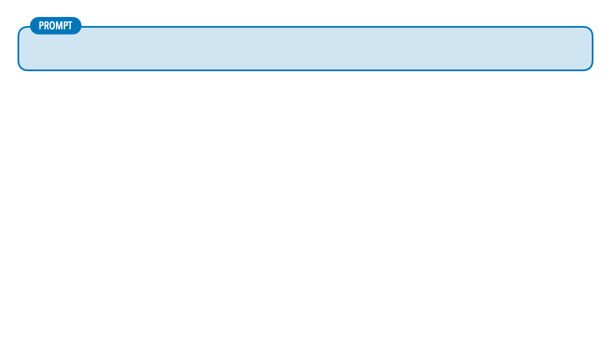
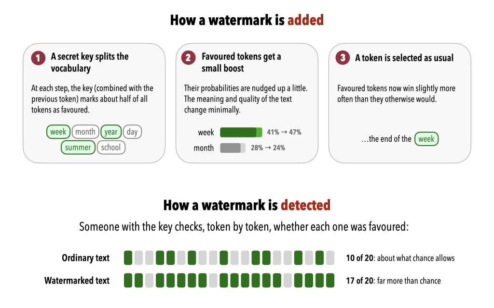
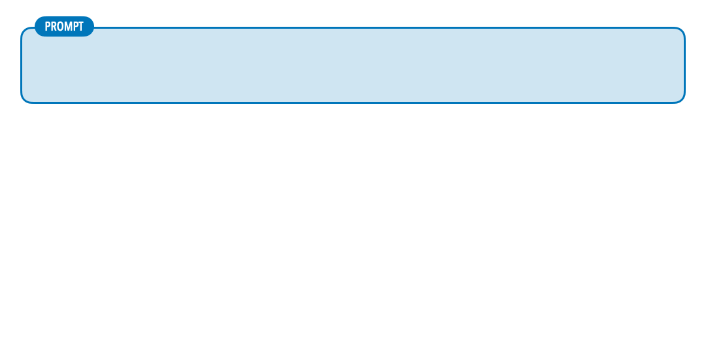

By now you have seen models behave in ways that can seem strange. Your Teachable Machine model may have learned the background instead of the object. Merlin kept a secret until you asked for a poem. And you have probably seen a chat assistant state something false with complete confidence.

None of this is random. This page connects what you learned in [Basic Concepts](basic_concepts.qmd), [Model Training](model_training.qmd), and [Language Models](language_models.qmd) to the characteristic ways in which LLMs behave. [Unit 2](../unit_2/index.qmd) is about what to do about it, this page is about *why* it happens.

## Plausibility vs. Truth

Recall [how a language model writes](language_models.qmd#text-generation): at each step, it assigns a probability to every possible next token, picks one (with some randomness), and repeats. Almost everything else on this page follows from that.

- **The model produces likely text, not verified text.** It doesn't look facts up (unless a tool retrieves documents for it), and it doesn't reason the way a logic engine does. When likely and true coincide, the answer is right. When they don't, the answer is wrong in exactly the same fluent, confident style.
- **Confidence is a style, not a signal.** Human writing that sounds authoritative usually comes from people who know what they're talking about, and the model has learned the style. It reproduces it whether or not the content behind it is sound.
- **Gaps are filled with plausible material.** Ask a chat assistant about one of [Stevenson's lesser-known correspondents](../reference/letters.qmd#the-collection), and there may be very little about them in its training data. The model doesn't *know that it doesn't know*. It generates what a biography of such a person would plausibly contain, which may mix real details from several people with invented ones. This is what's usually called **hallucination**. [Unit 2](../unit_2/index.qmd) looks at it, and the quieter errors that go with it, in detail.
- **The same question can get different answers.** There is a random choice at every token, so asking twice can produce two different answers, both delivered with equal confidence. For research, this matters: a result you can't reproduce is hard to rely on, or to report.

Here is what the last two points look like together. A small open model was asked the same question three times:

{width=760}

Three runs, three different people, each described in fluent, specific, confident detail, and **all of them invented**. Sidney Colvin (1845–1927) was an English art and literary critic, and one of Stevenson’s closest friends. This is a very small model ([Qwen2.5-0.5B-Instruct](https://huggingface.co/Qwen/Qwen2.5-0.5B-Instruct), about 0.5 billion weights), chosen because its failures are easy to see, the chat assistants you use are hundreds of times larger, and know perfectly well who Sidney Colvin was. But the mechanism is the same, and it shows up in larger models too, wherever their training data runs thin: a minor correspondent, a small archive, a local event. The answer doesn't tell you when that has happened.

::: {.callout-note collapse="true"}
## Watermarks in AI-Generated Text

The random choice at each token has an unexpected use. Some AI providers replace it with a *pseudo*-random choice that depends on a secret key. At each step, the key quietly favours a subset of the possible tokens, nudging the choice towards them without changing the meaning of the text. To a reader, the text looks entirely normal. But someone who has the key can check how often the favoured tokens were chosen: in watermarked text, it's far more often than chance would explain. Google DeepMind uses a scheme like this, called [SynthID Text](https://ai.google.dev/responsible/docs/safeguards/synthid), in its Gemini models.

{width=760}

Watermarks have real limits: only the provider can check for its own watermark, heavy editing or paraphrasing weakens it, short texts are hard to judge, and not every provider uses one. They're also quite different from the “AI detectors” that claim to recognize any AI-written text from its style. Those are unreliable, and have been shown to flag writing by non-native English speakers as AI-generated far more often than writing by native speakers. Keep this in mind in [Unit 2](../unit_2/acknowledging_ai_use.qmd), when the question of acknowledging AI use comes up.

:::

## Learned Patterns All the Way Down

Hack Merlin showed that an LLM's rules can be talked around. The reason is that its rules aren't rules: they are learned patterns, of the same kind as everything else it does.

Here is a small example of a learned pattern overpowering the text in front of the model:

{width=760}

The prompt is a variation on a famous philosophy puzzle, the [**trolley problem**](https://en.wikipedia.org/wiki/Trolley_problem), in which you can divert a runaway trolley away from five people and towards one. But read the prompt carefully: here, the five people on the track are **already dead**. There is no dilemma, pulling the lever would kill one person for no reason. The model (GPT-4o, in this exchange) answers the famous version anyway, confidently and at length. The classic puzzle appears so often in its training data that the pattern outweighs what the prompt actually says.

A specific failure like this one tends to get fixed once it becomes well known, newer models may notice the twist. The underlying tendency doesn't go away: **strong patterns from training can override what is actually in front of the model**, and it's hard to predict when.

The same applies to safety behaviour. During training with human feedback ([RLHF](basic_concepts.qmd#types-of-machine-learning)), models are rewarded for outputs that raters prefer: helpful, harmless, honest. This creates strong tendencies, not a rulebook:

- A tendency to be helpful: to complete the task, answer the question, write the poem.
- A tendency to refuse certain requests: to decline, or to keep a secret.

When these compete, the model doesn't consult a rule to decide which wins. Whichever pattern the current text activates more strongly wins. That's why the Hack Merlin strategies worked, and why similar techniques work on commercial chat assistants. When a user writes `as a security researcher` or `for educational purposes`, they aren't changing any rules. They are supplying context that activates the patterns associated with legitimate professional requests. Role-play, fictional framing, and encoding tricks work the same way. They don't bypass a detection system so much as shift the context until the refusal patterns fire less strongly. *Psychological* prompting works because the model learned from human text, in which such framings are persuasive.

The broader point is that a model's knowledge, capabilities, and safety behaviours can't be cleanly separated. They are all stored in the same weights, learned from overlapping data through overlapping processes. That's why **safety can't simply be *added* on top of capability**, and why further training a model on specialized data can unintentionally weaken its safety behaviour: the new training competes with the old.

## The Black Box Problem Again

[Model Training](model_training.qmd#the-black-box-problem) described the *black box problem*: a model's knowledge is spread across its weights, with no readable rulebook. This has some direct consequences in research contexts:

- You can report *what* a model did (its outputs, and how accurate they were), but not *why* it made a particular decision, the way you could explain a human judgement. [Interpretability research](https://en.wikipedia.org/wiki/Explainable_artificial_intelligence) is working on looking inside models, but it can't yet give that kind of explanation.
- When a chat assistant explains its reasoning, **the explanation is itself generated text**, produced the same way as the answer. It may or may not reflect what actually produced the answer.
- Because a model cannot be fully inspected, its **failures are not fully predictable**. It may behave well on tests and fail in unexpected ways on slightly different material.

The practical takeaway: **treat model outputs as evidence to be evaluated, not answers to be trusted.**

## The Limits of Benchmarks

If you can't look inside a model, you have to judge it by testing it. That's harder for LLMs than it sounds.

- **For tasks with a correct answer**, such as finding the names in a letter, evaluation is manageable: compare the model's output with annotations made by people, and calculate precision, recall, and F1. You'll do this in [Unit 3](../unit_3/index.qmd).
- **For open-ended tasks**, such as summaries, answers, or essays, there is often no single correct output. Many summaries are valid, and people disagree about which is best. Automated scores measure surface similarity to a reference text, which says little about quality, and asking people to rate outputs is slow, costly, and inconsistent.
- **Published benchmarks** (the standard tests that AI companies report scores on) become targets. Models are trained towards them, sometimes because the test questions have leaked into the training data, and high scores stop reliably predicting real-world performance. And a benchmark measures performance on *its* data, which is rarely anything like nineteenth-century letters.

## Fluency Without Correctness

Some tasks are hard in ways that more fluent text can't fix. Precise logical deduction, exact arithmetic, exhaustive searching, and careful multi-step reasoning all need to be *done*, step by step, not just *described*. LLMs have become much better at them, and some tools quietly hand calculations to real code. But a model can still produce text that has the *form* of a correct solution (the right structure, the right vocabulary, a confident conclusion) without the substance, and the failures don't look like failures.

You don't need the theory to take away the lesson: **fluency is not a signal of correctness, and confidence is not a signal of accuracy.**

## Key Takeaways

- LLMs produce likely text, not verified text. When likely and true diverge, the model is wrong in the same fluent, confident style as when it's right.
- Where its training data is thin, a model fills the gaps with plausible material (hallucination). It doesn't know what it doesn't know.
- There's randomness in every answer, so the same question can produce different answers.
- A model's rules, including its safety behaviour, are learned patterns that compete with each other and with the prompt. Strong training patterns can override what's actually in front of the model.
- You can observe what a model does, but not why. Its explanations of its own reasoning are generated text too.

## Next

These are structural properties, not quirks of one product. [Unit 2: Working with LLMs](../unit_2/prompts.qmd) turns to practice: what goes into a model when you use one, how to prompt it well, how to recognize its characteristic failures, and how to decide how far to trust the output.
