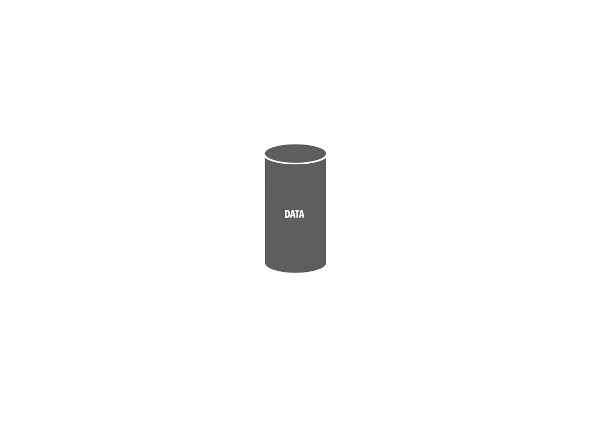
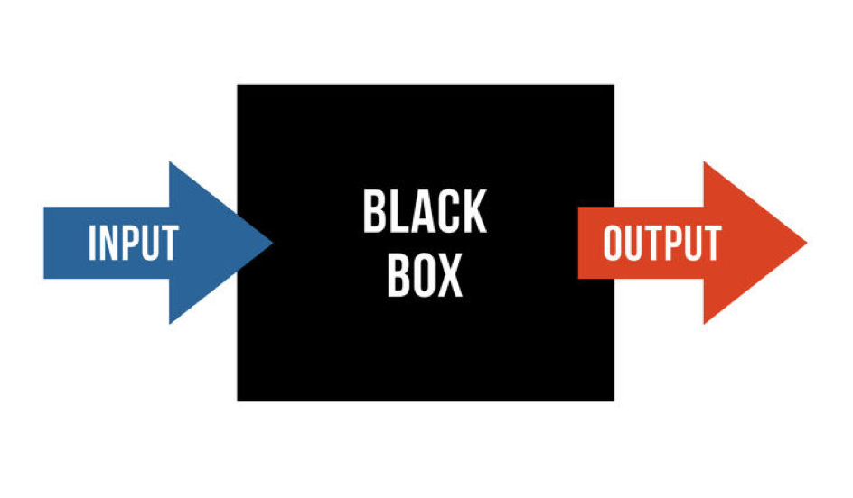

If you have done the [Teachable Machine activity](teachable_machine.qmd), then you have trained a model. This page connects that experience to what actually happens during training, how you find out whether it worked, and where bias gets in.

## From Experience to Concepts

When you collected training examples, what were you actually doing? You were defining what each class *looks like* to the machine, in terms of pixel values, sound frequencies, or body positions. The model found statistical patterns that separate those classes.

The model did not understand your concept. It learned to distinguish patterns in the data you gave it. The model in the [Teachable Machine videos](teachable_machine.qmd#an-experiment-shape-or-colour) could have learned colour instead of shape, since both separated its examples perfectly, only a green circle showed which it had picked up. In the same way, if all your examples of one class had a bright background, the model may have learned *bright background*, not the thing you meant.

That is the core insight of this reading: **models learn from data, and the data shapes everything**.

## The Training Loop

Training a model is not a single step, but a cycle:

{width=700 fig-alt="Animation of the training loop. The data is split into training, development, and test sets. The training set is used to train the model, the model predicts answers for the development set, the predictions are evaluated, the results guide tuning, and the cycle repeats. At the end, the test set is used once, for the final evaluation."}

1. **The data is split** into three parts before anything else happens: a **training** set, a **development** set, and a **test** set.
2. The model is **trained** on the training set.
3. The trained model **predicts** answers for the development set, which it hasn't seen.
4. Its predictions are **evaluated** against the correct answers.
5. The results guide **tuning**: adjusting settings such as how large the model is, or how long to train it.
6. The model is trained again, with the new settings, and the cycle repeats until the results stop improving.
7. Only then is the finished model run, once, on the **test** set, for the final, honest measure of how well it works.

The rest of this page takes each part of the loop in turn: the data, the training step, the evaluation, and what tuning is trying to avoid.

## The Data

### Training, Development, and Test Sets

A basic principle of machine learning is that you never judge a model by the data it was trained on [@jurafskySpeechLanguageProcessing2026, chap. 4]. That would be like grading students on questions they had already seen the answers to. That's why the data is split first:

- The **training set** is the examples the model learns from. It is usually the largest part.
- The **development set** (also called the *validation set*) is used during the cycle, to compare different versions of the model and choose between them.
- The **test set** is held back until the very end. It estimates how the model will perform on data it has never seen. If you tuned the model against the test set itself, it would gradually be fitted to it, and stop being a fair test.

You did this informally in Teachable Machine when you tried your model on new inputs that were not amongst your training samples.

### Bias in Training Data

The training set is the only thing the model learns from, so its contents matter enormously. Models learn what is in their data, including its gaps, imbalances, and historical assumptions. That old chestnut, [“Garbage in, garbage out”](https://en.wikipedia.org/wiki/Garbage_in,_garbage_out), applies and, at scale, the effects can be amplified [@zhaoMenAlsoShopping2017].

- **At collection:** if a model is trained on text that reflects historical inequities, it will reproduce those patterns in its outputs. Early word-embedding models, for example, placed “nurse” closer to “woman” and “doctor” closer to “man” [@bolukbasiManComputerProgrammer2016; @caliskanSemanticsDerivedAutomatically2017] (we'll cover [Word Embeddings](language_models.qmd#word-embeddings) later in this unit). Nobody programmed this, it reflected patterns in the training corpus.
- **Coverage:** a model trained on material that under-represents certain communities, languages, or periods will perform worse on materials from them. Most widely used language tools were trained overwhelmingly on recent, English-language web text [@joshi-etal-2020-state; @benderDangersStochasticParrots2021; @touvronLlama2Open2023]. This is a significant equity concern for computational work on cultural heritage [@ehrmannNamedEntityRecognition2023], and a practical one for anyone working with historical sources.
- **At labelling:** who annotated the data, and what assumptions did they bring? Are the label categories themselves culturally loaded? You'll annotate letters yourself in Unit 3, and find how many judgement calls labelling involves.
- **In model design:** choices about what to predict, which categories to use, and what counts as success all shape the result [@gebruDatasheetsDatasets2021; @barocasFairnessMachineLearning2023].

Bias is not simply a bug to be fixed. It is a property of the data and of the choices made in collecting and curating it [@sureshFrameworkUnderstandingSources2021]. And because the development and test sets usually come from the same source as the training set, they share its gaps: a model can do well on its test set and still fail on material that none of its data represented.

## Training: Loss and Optimization

[Basic Concepts](basic_concepts.qmd#neural-networks-and-weights) described a network's weights as what it learns. The `train` step of the loop is how the weights get there. Inside it lies a smaller loop of its own:

1. The model starts with random weights.
2. It processes a training example and makes a prediction.
3. It compares the prediction with the correct answer and calculates how wrong it was. This measure of error is called the [**loss**](https://en.wikipedia.org/wiki/Loss_function). If the right answer is `Green Square` and the model confidently says `Orange Circle`, the loss is high.
4. It adjusts its weights slightly, in whichever direction reduces the loss.

{.img-right width=500 fig-alt="Line chart of loss over 50 epochs: the training loss and the validation loss both start at about 2.3, and fall together, with small bumps, to about 1.65."}

It repeats this over thousands or millions of examples, and over many passes through the whole training set (called *epochs*). The chart shows what that looks like: the loss starts high and falls, epoch by epoch, as the weights improve. The two lines show the loss on the training set and on the development set, here they fall together, which is a good sign (see [Overfitting](#tuning-overfitting-and-generalization) below).

The adjustment step uses an algorithm called [gradient descent](https://en.wikipedia.org/wiki/Gradient_descent). A useful picture is a ball rolling downhill: the landscape is the loss, and the ball settles into a low point, which is a set of weights that makes few mistakes on the training data [@goodfellowDeepLearning2016, chaps. 4, 8].

This is **[optimization](https://en.wikipedia.org/wiki/Mathematical_optimization), not understanding**. The system is tuning numbers to reduce its errors. The patterns it learns reflect statistical regularities in the data. The system has no intentions, and whether those patterns ever add up to anything like a model of the world is a live debate among researchers [@benderClimbingNLUMeaning2020; @liEmergentWorldRepresentations2022; @gurneeLanguageModelsRepresent2024; @mitchellDebateUnderstandingAIs2023]. Everything that follows (capability, failure, bias, evaluation) flows from this basic fact: **the system learned from data, and what's in the data shapes everything.**

## Measuring Performance

The `evaluate` step hides an important question: *measured how?* The obvious measure is *accuracy*: what fraction of the model's answers are correct? But accuracy can mislead.

Suppose a model reads [Stevenson's letters](../reference/letters.qmd) word for word and, for each word, it decides whether it is a place name or not. The vast majority of words in a letter are *not* place names, so a model that never marks anything as a place name would be more than 95% accurate, and completely useless.

That's why evaluation usually separates two kinds of error:

- **Precision:** of all the words the model marked as place names, how many really are so? Low precision means *false alarms*.
- **Recall:** of all the place names actually in the letters, how many did the model find? Low recall means *misses*.

The two are often in tension, and which matters more depends on your research goal. If you're building a map of every place Stevenson mentions and will check the results by hand anyway, you care most about recall (don't miss places), since you can weed out false alarms yourself. If you're publishing counts without checking, false alarms matter just as much. A third measure, **F1**, combines precision and recall into a single score [@vanrijsbergenInformationRetrieval1979, chap. 7; @jurafskySpeechLanguageProcessing2026, chap. 4].

For a step-by-step example with numbers, see [Evaluation Metrics](evaluation_metrics.qmd). You will calculate these measures yourself in Unit 3, comparing a model's output against annotations of the letters made by people.

## Tuning: Overfitting and Generalization

What is tuning trying to achieve? Not simply a lower loss on the training data. Think of a student who memorizes past exam papers instead of learning the material: they ace the practice tests but struggle on the real exam, because the real exam asks new questions.

{.img-right width=500 fig-alt="Animation: data points over time that fall and then rise. A straight line misses the pattern (underfitted), a wiggly line passes through every single point (overfitted), and a smooth curve follows the real trend (a good fit)."}

Models can do the same. **[Overfitting](https://en.wikipedia.org/wiki/Overfitting)** happens when a model learns its training data *too well*, including its noise and quirks. It performs well on the training data and poorly on anything new. The goal of model training is **generalization**: doing well on examples the model has never seen. This is exactly what the development set is for: if the loss keeps falling on the training set but starts rising on the development set, the model has begun to memorize [@jamesIntroductionStatisticalLearning2023, chap. 2].

- In Teachable Machine terms: if every green square had been photographed on a desk and every orange circle on the floor, the model may have learned `desk` as part of `green square`. New examples in a different setting will fail.
- The opposite problem is **underfitting**: a model too simple to capture the real pattern, which does poorly everywhere. The figure with the data points shows all three: a model that misses the pattern, one that captures it, and one that follows every quirk of its training points.

{.img-right width=450 fig-alt="Chart of error against model complexity: as complexity grows, bias falls and variance rises, so the total error is U-shaped, and lowest at an optimum complexity in the middle."}

- Good models sit somewhere in between: complex enough to capture real patterns, not so complex that they memorize noise. This is known as the [bias–variance tradeoff](https://en.wikipedia.org/wiki/Bias%E2%80%93variance_tradeoff) (a different sense of *bias* from the one above): as a model gets more complex, errors from oversimplifying fall and errors from memorizing rise, and the best total sits in the middle [@jamesIntroductionStatisticalLearning2023, chap. 2]. (Very large neural networks complicate this picture: past a certain size, their errors can fall again, which researchers call [*double descent*](https://en.wikipedia.org/wiki/Double_descent) [@belkinReconcilingModernMachine2019].)
- Tuning is largely about finding that middle. Common remedies for overfitting include more diverse training data, simpler models, techniques that limit how far the model can adjust ([regularization](https://en.wikipedia.org/wiki/Regularization_(mathematics))), and stopping training before the model starts to overfit ([early stopping](https://en.wikipedia.org/wiki/Early_stopping)) [@goodfellowDeepLearning2016, chap. 7].

Even a model that generalizes well only generalizes to data *like its training data*. A model trained mostly on modern news articles may be excellent on news and much worse on nineteenth-century letters, with their archaic spellings, and people known only to the writer [@ehrmannNamedEntityRecognition2023]. You will measure exactly this in [Unit 3](../unit_3/index.qmd).

## The Black Box Problem

{.img-right width=350 fig-alt="Diagram: an arrow labelled Input goes into a black box, and an arrow labelled Output comes out of it."}

Once a model is trained, its *knowledge* is spread across millions or billions of weights. There is no readable rulebook. You can measure what the model **does**, but you cannot open it up and read **what it learned** [@burrellHowMachineThinks2016; @rudinStopExplainingBlack2019a].

This matters most for bias. If a model was trained on skewed or unrepresentative data, that bias is encoded in the weights, but you usually can't point to where it lives [@mengLocatingEditingFactual2022]. You can only probe the model's behaviour: give it inputs and observe its outputs across a carefully built evaluation set. [LLM Behaviour](llm_behaviour.qmd) returns to what this means for LLMs.

## Key Takeaways

- Training is a cycle: split the data, train, predict, evaluate, tune, and repeat, with a final test at the end.
- Models are judged on data they haven't seen: the development set during tuning, and the test set, once, at the end.
- The training data is all a model learns from. Its gaps and assumptions become the model's, through collection, coverage, labelling, and design choices.
- Training itself is optimization: the model repeatedly measures its error (the loss) and adjusts its weights to reduce it. It doesn't understand, it fits.
- Accuracy alone can mislead. Precision and recall measure different kinds of error, and which matters more depends on your research goal.
- A model that memorizes its training data (overfitting) fails on new data, and even a model that generalizes well only generalizes to data like its training data.
- A trained model is a black box: you can measure what it does, but not read off what it learned.

::: {.callout-note}
## Going Further

If you want to read more, the following are a good place to start:

- @burrellHowMachineThinks2016: an essay, written for social scientists, on the different reasons machine learning models are hard to understand, and why that matters when they're used to make decisions.
- Kate Crawford and Trevor Paglen, [*Excavating AI*](https://excavating.ai) (2019): an essay by a scholar and an artist on the images and categories that a famous training dataset for image recognition was built from, and the assumptions built into them.
- @benderDangersStochasticParrots2021: a widely read critique of training language models on ever larger collections of web text, including whose language and views that text represents. Its sections on training data need no technical background.
- @mitchellDebateUnderstandingAIs2023: a short overview of the debate over whether language models *understand* anything.
:::

## References

::: {#refs}
:::
