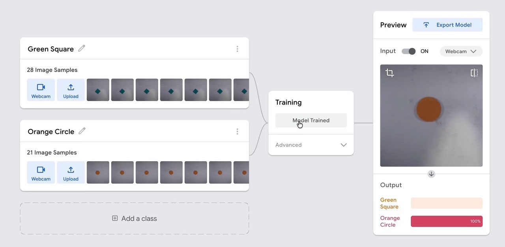
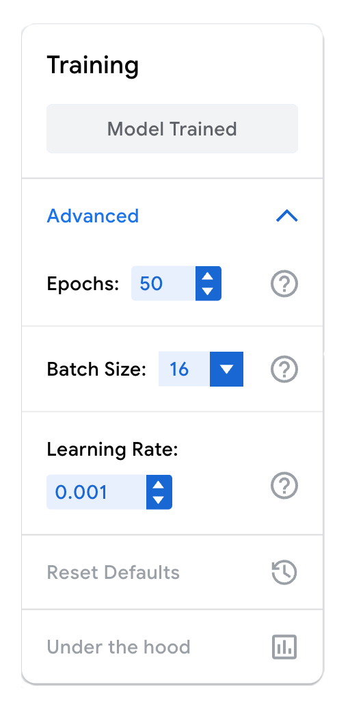
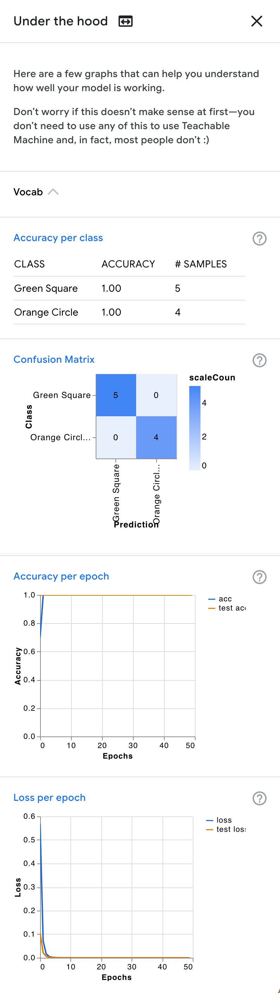
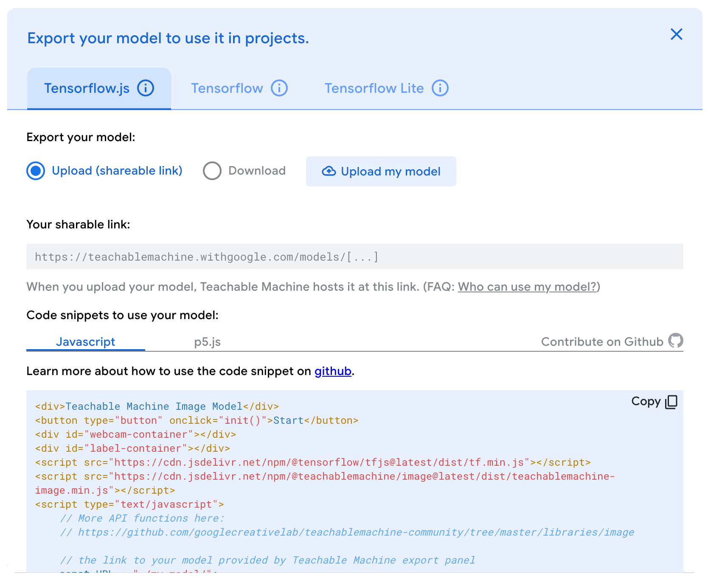

::: {.callout-note collapse="true"}
## Activity Details

**Time:** about 30 minutes  
**Works:** on your own, or in a small group  
**You need:** a web browser and a webcam (for image or pose models) or a microphone (for sound models)  
**URL:** [teachablemachine.withgoogle.com](https://teachablemachine.withgoogle.com)
:::

This activity is about the most basic idea in machine learning: that a model learns from examples, and only from examples. [Teachable Machine](https://teachablemachine.withgoogle.com) is a free Google tool that lets you train a small image, sound, or pose classifier in your browser, with no code. You decide on the categories, show it examples of each, and it trains a model to tell them apart.

The goal is not to build a useful model. It is to develop an intuition for what training data is, how your choices of categories and examples shape a model, and what “training” involves in practice. What you do here mirrors, on a tiny scale, what happens inside much larger models. You'll also see, in miniature, the training cycle that [Model Training](model_training.qmd) describes next.

{fig-alt="The Teachable Machine training screen: two classes, Green Square and Orange Circle, each with image samples; the Training panel shows Model Trained; the Preview panel shows the webcam view of an orange paper circle, classified as Orange Circle with 100% confidence."}

Before you start, you may want to read [Basic Concepts](basic_concepts.qmd), especially [From Rules to Examples](basic_concepts.qmd#from-rules-to-examples).

::: {.callout-warning}
## About the Tool
Teachable Machine is a third-party site and may change over time. Your images and sounds are processed in your browser and are not uploaded unless you choose to export your model to the cloud.
:::

## Transfer Learning

When you click Train Model, Teachable Machine doesn't build a model from nothing. It starts from a model that has already been trained, by Google, on millions of images (or sounds, or poses), and has learned general visual features: edges, textures, shapes. It then trains only the last part of that model, on your examples, to separate *your* classes. This is called [**transfer learning**](https://en.wikipedia.org/wiki/Transfer_learning), and it's why a few dozen examples are enough, where training from scratch would need thousands. (The NER models in Unit 3 are *pre-trained* in the same sense.)

{.img-right width=220 fig-alt="The Advanced section of the Training panel: Epochs 50, Batch Size 16, Learning Rate 0.001, Reset Defaults, and Under the hood."}

Training follows the cycle you'll read about in [Model Training](model_training.qmd#the-training-loop), in short:

- **It splits your examples.** For each class, 15% of the samples (rounded up) are held back to test the model on examples it hasn't seen, and the rest are used for training.
- **It trains in epochs.** Each *epoch* is one pass through all your training samples, adjusting the model's weights a little each time.
- **It shows you the result.** The `Preview` panel runs the trained model live on your webcam or microphone, with a bar for each class showing how confident it is.

You don't need to change any settings to do the activity. But if you open Advanced, under Train Model, you'll find the settings that control training: the number of `Epochs` (50 by default), the `Batch Size` (how many samples the model looks at before each adjustment of its weights), and the `Learning Rate` (how big each adjustment is). [Model Training](model_training.qmd#training-loss-and-optimization) explains the cycle of adjustments these settings control.

Under the hood, at the bottom of the same section, shows how well the model did on the samples it held back. For the model in the videos, it held back 5 of the 28 green-square samples and 4 of the 21 orange-circle samples, and got all 9 right: 100% accuracy on the test samples, reached in about one epoch.

That sounds perfect, but look at what those 9 samples were: taken in the same minute, on the same desk, in the same light as the training samples. A perfect score on them tells you the model learned to separate *those* pictures. It doesn't tell you what the model will do in another room, which is what [Part 2](teachable_machine.qmd#part-2-testing-a-model) is about.

::: {.callout-note collapse="true"}
## Under the Hood

This is the Under the Hood panel for the model in the videos:

{.lightbox width=400 fig-alt="Teachable Machine's Under the hood panel: accuracy per class (Green Square 1.00 on 5 samples, Orange Circle 1.00 on 4 samples), a confusion matrix with no errors, and charts of accuracy and loss per epoch for the training and test samples, both reaching their best values within a few epochs."}

From the top: accuracy for each class on the test samples; a [confusion matrix](evaluation_metrics.qmd), showing which class the model predicted for each test sample; and accuracy and loss for each epoch, on the training samples (blue) and the test samples (orange). Click the image to enlarge it.
:::

## Part 1: Training a Model

The videos below show the whole process, with two classes: a green paper square and an orange paper circle. They have no sound. Watch them first, or refer back to them as you go.

::: {.panel-tabset}
### Starting a Project

{poster="../assets/teachable_machine/start.jpg" preload="none"}

Step 1: from the home page, Get Started, then Image Project → Standard image model.

### Adding Samples

{poster="../assets/teachable_machine/samples.jpg" preload="none"}

Steps 2–3: rename the classes, then hold Hold to Record to capture webcam samples for each one.

### Training

{poster="../assets/teachable_machine/train.jpg" autoplay="" loop="" muted="" playsinline=""}

Step 4: Train Model. (The progress bar is sped up.)

### Testing

{poster="../assets/teachable_machine/test.jpg" preload="none"}

Step 5: the `Preview` panel classifies the webcam image live. Notice what happens when both shapes are in view.
:::

1. Go to [teachablemachine.withgoogle.com](https://teachablemachine.withgoogle.com), click Get Started, and create a new project. If you're not sure which to pick, choose Image Project → Standard image model, it is the easiest to work with.
2. Define two or three categories (Teachable Machine calls them *classes*). Rename them from `Class 1` and `Class 2` by clicking the pencil icon. Keep them simple and clearly distinguishable: hat/no hat, thumbs up/thumbs down, a mug/a book, or two shapes cut from coloured paper, as in the videos.
3. Collect samples for each class, using Webcam (hold the button to record a burst of images) or Upload. Aim for a few dozen samples per class.
4. Click Train Model, and keep the tab open while it trains. It takes from a few seconds to a minute.
5. Test the model in the `Preview` panel: show it each of your classes, and watch the confidence bars.
6. Keep experimenting: add more samples to one class and retrain. Does the model's behaviour change for the other classes too?

{.img-right .lightbox width=320 fig-alt="The Export Model dialog: the Tensorflow.js tab, with Upload (shareable link) selected, an Upload my model button, an empty sharable link, and code snippets for using the model."}

As you work, notice the assumptions you are building in. What makes something count as a *hat*? What did you include in your examples without meaning to: the background, the lighting, your face, the angle of the camera? The model has no idea which of these you meant it to learn.

**In a group:** work in groups of 3–4. When you're done, export your model: click Export Model, and on the Tensorflow.js tab choose Upload (shareable link), then click Upload my model. Copy the sharable link that appears, and share it with another group, along with the data type, your categories, and a one-line description of what the model does. The link shares the trained model, not the images you trained it on.

## Part 2: Testing a Model

Now try to break a model: yours, or another group's.

**On your own:** test your model under conditions that differ from your training data:

- change the lighting or the background
- move closer to or farther from the camera, or tilt it
- ask someone else to try it, or use objects that are similar but not identical to your examples
- show it something that belongs to *none* of your classes

**With someone else's model:** in a group, open another group's model link. On your own, try [the model from the videos](https://teachablemachine.withgoogle.com/models/2M-kB6nDp/), trained on a green paper square and an orange paper circle: draw, cut out, or find some shapes to show it. Whichever model you use, read what it is for, and predict how it will behave *before* you test it.

Either way, here are some things to look for:

- Does the model work as described?
- Which inputs does it misclassify? What does that reveal about the training data?
- What happens with ambiguous or unusual examples?

Focus on *why* the model fails when it does, not just *that* it fails. The failures are the most instructive part of this exercise.

::: {.callout-tip collapse="true"}
## Expected Results

- **It works well on examples like its training data, and much less well on anything else.** A model trained in one room, in one light, often fails in another.
- **It learns shortcuts.** If everything in one class shared a background, a colour, or a person, the model may have learned that instead of the thing you meant. You'll often find this out only by changing that one thing.
- **It's always confident about something.** Show it something that belongs to none of your classes, and it still has to choose one, often with high confidence. A classifier can only answer the question it was trained on: it has no way of saying "none of these".
- **More examples of one class can change the others.** The model learns what *separates* the classes, so changing one changes the boundary for all of them.
:::

### An Experiment: Shape or Colour

The model in the videos was trained on green squares and orange circles. Every example it saw differed in two ways at once, shape *and* colour, so either one would separate the classes perfectly. Which did it learn?

Predict, before you look: what will it say about a green circle? And an orange square?

::: {.callout-note collapse="true"}
## Answer

{poster="../assets/teachable_machine/colour_shape.jpg" preload="none"}

The model learned shapes. The green circle came out as Orange Circle (96%), and the orange square as Green Square (99–100%).

That's what we wanted, but nothing in the training data could have told us so in advance: both explanations fit every example the model had seen. Only an input that pulls the two apart, a green circle, could reveal which one it had learned. With different samples (other lighting, other paper, other shapes) it could have gone the other way. To find out what a model has learned, you have to test it on the cases your training data didn't cover.
:::

## Explaining Model Behaviour

Everything the model knows comes from your examples. It found whatever statistical pattern best separated your classes in the samples you gave it, and that pattern may or may not be the one you had in mind. It can't tell the difference between the object and everything else in the picture, unless your examples made the difference clear: the same object in different places, lights, and angles, and different objects in the same place.

This is the same for every model, including the largest of them. The data is where the model's abilities come from, and also where its blind spots come from. [Model Training](model_training.qmd) looks at how this works, and why testing a model on data unlike its training data is the only way to find out what it actually learned.

## Key Takeaways

- Training a model means choosing categories and examples, and every choice builds in assumptions.
- A model learns whatever separates your examples, which may not be what you intended: the background, the lighting, your face.
- A classifier always picks one of its classes, even for inputs that belong to none of them, and its confidence doesn't tell you when it's wrong.
- The real test of a model is data that differs from its training data. How and why it fails there tells you what it actually learned.
- Large models are trained on the same basic principle, at vastly greater scale, with the same dependence on their data.

## Next

[Model Training](model_training.qmd) connects this experience to what actually happens during training, how you find out whether it worked, and where bias gets in.
