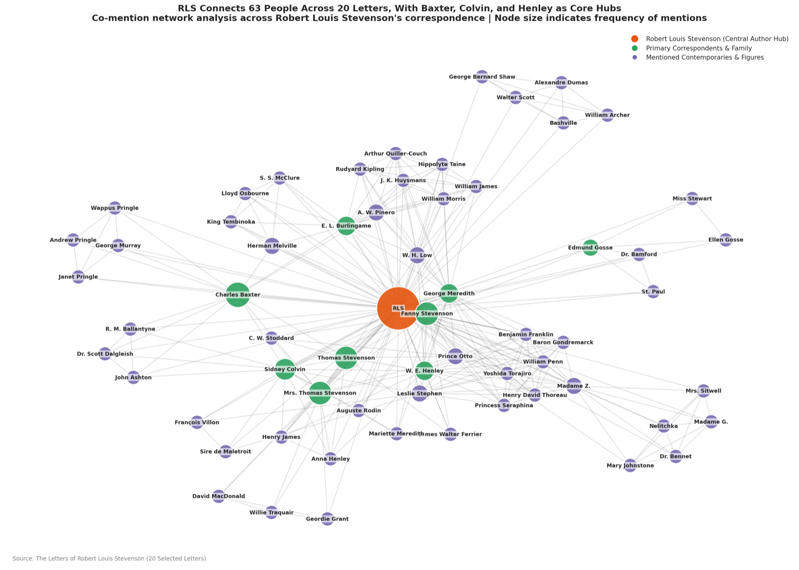
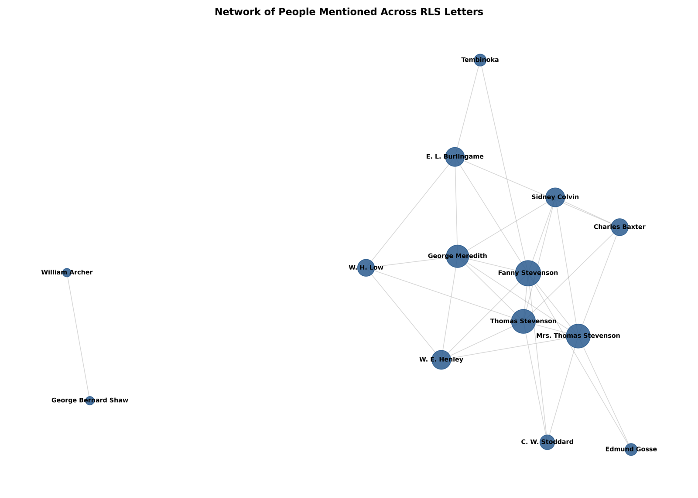

::: {.callout-note collapse="true"}
## Activity Details

**Time:** about 60 minutes  
**Setup:** on your own, or in pairs  
**Requirements:** a Google account, the 20 sample letters in [`data/sample_letters/`](https://github.com/gpizzorno/understanding-ai/blob/main/data/sample_letters/), and, for Part 3, the combined file [`data/stevenson_letters_combined.md`](https://github.com/gpizzorno/understanding-ai/blob/main/data/stevenson_letters_combined.md)  
**URL:** [notebook.google.com](https://notebook.google.com)
:::

So far in this unit, you've worked with a single letter in a chat assistant. In this activity you'll use a research tool built for working with your own sources, on a real research task: finding the people, places, and organizations mentioned across a set of [historical letters](../reference/letters.qmd). This task is called [**named-entity recognition (NER)**](https://en.wikipedia.org/wiki/Named-entity_recognition), and it's a common first step for indexing a collection, mapping it, or analyzing a network of correspondents [@grishmanMessageUnderstandingConference1996; @nadeauSurveyNamedEntity2007a; @ehrmannNamedEntityRecognition2023; @jurafskySpeechLanguageProcessing2026, chap. 18].

**Gemini Notebook** (called NotebookLM [before July 2026](https://blog.google/innovation-and-ai/products/gemini-notebook/notebooklm-gemini-notebook/)) is Google's tool for working with your own documents: you upload sources, and it answers questions about them, citing the passages it used. Google doesn't say exactly how it works behind the scenes, but tools like it use [retrieval-augmented generation](prompts.qmd#the-models-actual-input): they search your sources for passages relevant to each question, and give those to the model, at least when the sources are too long to send in full. It can also [run code](https://blog.google/innovation-and-ai/products/gemini-notebook/notebooklm-gemini-notebook/), which lets it count, build tables, and draw charts.

It is a genuinely capable tool, and you'll find it does most of what you ask. The point of this activity is to find out what the output is, and whether you could rely on it for research: could you check the output, and could you reliably get the same results across multiple runs?

::: {.callout-warning}
## About the Tool
Gemini Notebook is a third-party Google service. Its features and limits change over time. The descriptions below were tested at the time of writing. The letters are public-domain texts, so uploading them raises no privacy or copyright concerns, however, you should think carefully before uploading unpublished or sensitive material of your own to any hosted AI tool.
:::

## Setup

1. Download the 20 `.txt` files from [`data/sample_letters/`](https://github.com/gpizzorno/understanding-ai/blob/main/data/sample_letters/) (or use your local copy of this repository).
2. Go to [notebook.google.com](https://notebook.google.com), sign in, and create a new notebook.
3. Add the 20 letters as sources. They're plain-text files and upload easily. Gemini Notebook will write a short description of your sources and suggest some questions.

{poster="../assets/gemini_notebook/start.jpg" preload="none" aria-label="Screen recording: creating a notebook in Gemini Notebook and adding the 20 letters as sources. The tool then writes a short summary of them, and suggests questions."}

The screen has three panels: your **sources** on the left, the **chat** in the middle, and the **studio** on the right, where files, reports, and other things the tool creates for you are saved. Above each answer, a collapsed Thoughts panel shows the steps the model took, including when it ran code.

The videos on this page are from our test, sped up, with the waits cut out (the longest answers took two or three minutes). They have no sound.

## Part 1: Exploration

Start by exploring, as you would with a new collection. Try some of these prompts, or use your own:

- 
Identify all the people mentioned across these letters. For each person, note their name as written and their apparent relationship to RLS.

- 
Based on these letters, describe RLS's social and professional network. Who are the most important people, and what roles do they play?

- 
Who is "Colvin"? Can you tell from context? Is he always referred to the same way?

- 
What is RLS working on or worried about in these letters?

You'll likely find the answers rich, context-aware, and backed by citations you can click to see the passage in the letter. Then ask:

How many times is Colvin mentioned across all the letters? List every mention, with the letter it appears in and the exact words used.

::: {.panel-tabset}
### Identifying the People

{poster="../assets/gemini_notebook/people.jpg" preload="none" aria-label="Screen recording: asking Gemini Notebook to identify the people mentioned in the letters, its answer, and the Thoughts panel opened to show its steps, including Executed code."}

The first prompt above, the answer, and the Thoughts panel, opened to show the steps, including `Executed code`.

### Counting the Mentions of Colvin

{poster="../assets/gemini_notebook/colvin.jpg" preload="none" aria-label="Screen recording: asking Gemini Notebook how many times Colvin is mentioned, and its answer: four mentions by name in three letters, and one by initials in a fourth."}

The Colvin prompt, and the answer: four mentions by name in three letters, and one by initials in a fourth.
:::

::: {.callout-tip}
## Points to Notice

- **It counts, and it probably counts well.** In our test, it ran code (look for `Executed code` in the Thoughts panel), and found five mentions in four letters, quoting each one: the heading `TO SIDNEY COLVIN` and the salutation `MY DEAR COLVIN` in one letter, `Colvin` in the body of two others, and `S. C.` in a letter to Henley: `Did I tell you that S. C. had risen to the paper on James?`
- **That last one is impressive.** A keyword search for `Colvin` would miss `S. C.`, and recognizing that the initials mean Sidney Colvin takes context. This is the *entity resolution* problem: the same person, written in different ways [@binetteAlmostAllEntity2022; @jurafskySpeechLanguageProcessing2026, chap. 24]. You'll find it again in Unit 3.
- **But how would you know the count is right?** You'd have to read the 20 letters yourself. Keep that question in mind.
:::

## Part 2: Structured Output

Now ask for the kind of output a research project needs: data you can sort, count, and analyze.

1. Ask:

   ::: {.prompt}
   Extract every named person, place, and organization mentioned in these letters. Output a CSV file with the columns: file_name, entity_text, entity_type. Use PER, LOC, and ORG as entity types. Record entity_text exactly as written in the letter. Include every mention, not just unique names.
   :::

2. When it's done, find the file in the **Studio** panel, and download it (⋮ → Download). Open it in a spreadsheet program. **Save it**: you'll need it in Part 3.
3. Ask: 
Create a network graph of the people mentioned in these letters, connecting two people when they are mentioned in the same letter.

::: {.panel-tabset}
### Exporting a CSV File

{poster="../assets/gemini_notebook/csv.jpg" preload="none" aria-label="Screen recording: asking Gemini Notebook for a CSV file of the people, places, and organizations in the letters, its answer, and downloading the file from the Studio panel."}

Steps 1 and 2: the CSV prompt, the answer, and the file in the Studio panel, with its menu open to download it.

### Drawing a Network

{poster="../assets/gemini_notebook/network.jpg" preload="none" aria-label="Screen recording: asking Gemini Notebook to draw a network of the people mentioned in the letters, its answer, and the image saved in the Studio panel."}

Step 3: the network prompt, and the answer. The image is saved in the Studio panel, above the CSV file.
:::

::: {.callout-note #ltc-step-3}
## The Letter to Colvin: Step 3 of 6

Filter the spreadsheet you downloaded to `wikisource_vol1_ch3_letter14.txt`, and compare the rows with the table you built in [step 2 of this exercise](prompting_strategies.qmd#ltc-step-2).
:::

::: {.callout-tip}
## Points to Notice

- **It works.** In our test, it produced a real, downloadable CSV file covering all 20 letters (320 to 330 rows), and a clear network image with sensible clusters of correspondents.
- **It's also quite accurate.** Measured against annotations made by people, its results were considerably better than the specialized NER model you'll use in Unit 3 for people and organizations, and as good for places. You'll see the numbers in the Unit 3 notebook, which evaluates exactly these exports.
- **But look at the letter to Colvin.** In our test, it tagged `Villon` and `Sire de Maletroit` as *people*. Both are Stevenson's works, not people (`Villon` is his name for a story and an essay about the poet François Villon). If your step-2 table got this right, it's because your prompt asked about titles of works, and your follow-ups made the model check. The export had no such prompting, and no one looked.
- **Can you get the data behind the network?** You can see the picture. Can you download the list of connections, to check it or to use it elsewhere?

:::

## Part 3: Reliability

The output looks like research data. The questions in this part are the ones a reviewer, a collaborator, or your future self would ask about it. Try each one, and note what happens before opening the explanation.

1. **Repeat it.** Run the exact CSV prompt from Part 2 again, and download the second file. Compare the two: how many rows does each have? Pick a letter, and compare its rows.
2. **Ask for the code.** Show me the exact code you ran to produce the CSV file.
3. **Ask for the steps.** What exact steps did you take to produce the network graph? Could I reproduce them myself? If it gives you a script, compare what the script would draw with the image you got.
4. **Find the version.** Which model produced your results? Look for a model name or version anywhere in the interface.
5. **Scale it up.** The full corpus has 462 letters. Try adding them all as sources (from [`data/letters/`](https://github.com/gpizzorno/understanding-ai/blob/main/data/letters/)) to a new notebook. Then try the workaround: a new notebook with the single file [`stevenson_letters_combined.md`](https://github.com/gpizzorno/understanding-ai/blob/main/data/stevenson_letters_combined.md), which contains all 462 letters, each under a heading with its file name. Ask a question about one specific letter, then ask for the CSV for the whole corpus.

::: {.callout-tip collapse="true"}
## Expected Results

1. **The second run is different.** In our test, two runs of the identical prompt produced 327 and 325 rows, of which only 288 were the same: 39 rows appeared only in the first run, and 37 only in the second, and several mentions changed type between runs (`Royal Hotel` from an organization to a place, `Clifton` from a person to a place). The overall accuracy was almost the same, but the *data* wasn't: any count, network, or map built from it would change too. And it's hard even to repeat the test under the same conditions: there is an option to delete a notebook's chat history, but in our test it didn't seem to clear it. A week later, in a new notebook, the same prompt gave 320 rows, of which about 290 matched each earlier run.
2. **The code isn't available.** The Thoughts panel says `Executed code`, but the code itself isn't shown, and can't be downloaded.
3. **The *steps* are a reconstruction.** In our test, the tool described its method and offered a complete Python script, presented as a way to reproduce the graph. We ran [the script](https://github.com/gpizzorno/understanding-ai/blob/main/data/gemini_notebook/network_graph_code.py), unchanged, on the same 20 letters:

   ::: {layout-ncol="2"}
   {.lightbox group="network" fig-alt="A network of 63 people in three colours, with a legend, and a large node for Stevenson at the centre."}

   {.lightbox group="network" fig-alt="A network of 14 people, all in one colour, with no legend and no node for Stevenson. Two of the people are connected only to each other."}
   :::

   The tool's graph has 63 people in three colour-coded groups, with RLS at the centre, and counts characters from Stevenson's stories, such as *Prince Otto* and *Princess Seraphina*, as people. The script's graph has 14 people, in one colour, without RLS. It doesn't use the CSV, or any list of entities: it searches the letters for a short list of names written into the script, and for words like `father`, `mother`, and `my wife`, so any father in any letter counts as Stevenson's father. It's a plausible method, written after the fact, the same way as any other answer, but it isn't what produced the image. [LLM Behaviour](../unit_1/llm_behaviour.qmd#the-black-box-problem-again) warned about this.
4. **There's no version.** No model version is shown anywhere: Google's announcements name the family of models, but not the version behind a given answer. If the product is updated next month, the same prompt may give different results, and you won't be told [@chenHowChatGPTsBehavior2024].
5. **Scale is a soft limit.** A notebook holds 50 sources on the free plan, and 100 to 600 on [paid plans](https://support.google.com/notebooklm/answer/16213268), so on most plans you can't upload all 462 letters as separate files. The combined file works around it: the tool answers questions about individual letters correctly, because the headings let it find them. But when you ask for the whole corpus, remember that, with a collection this size, the model probably works from passages a search picked out, not the whole file. Does your CSV cover all 462 letters? How would you check?

:::

## Implications

Gemini Notebook is a solid tool. It resolved `S. C.` to Sidney Colvin, produced a real data file, and drew a useful network, and its extractions of people and organizations were more accurate than a specialized model's. For exploring a collection, asking questions of it, and getting a first draft of structured data, it's excellent.

What it can't give you is what research data needs on top of accuracy:

- **Reproducibility:** the same request gives different data.
- **Transparency:** you can't see the code that produced your results, and the tool's own account of its method isn't reliable.
- **A fixed version:** you can't say which model produced your results, or get the same one again.
- **Verifiability:** you can't measure the accuracy once and rely on the measurement, because the next run is different.

None of these is a flaw in the product: they come with conversational tools in general. [Assessing Reliability](assessing_reliability.qmd) turns to how you decide how far to trust output like this. [Unit 3](../unit_3/index.qmd) builds a pipeline that gives up some of the accuracy in exchange for all four, and then evaluates it side by side with the exports you've just made.

## Key Takeaways

- A research tool like Gemini Notebook can count, resolve names from context, export real data files, and draw charts, and do it well.
- The same request can produce different data: similar accuracy, different rows.
- You can't see the code behind the results, and the tool's explanation of its own method may not match what it did.
- No model version is shown, so results can't be tied to a specific model, or reproduced later.
- For exploration, that's fine. For data you'll count, publish, or build on, you need to be able to check it and repeat it.

::: {.callout-note}
## Going Further

If you want to read more, the following is a good place to start:

- @chenHowChatGPTsBehavior2024: a short study of how the answers of the same chat assistant changed over three months, on the same questions, without any announcement. It shows why a result from a conversational tool is hard to reproduce.
:::

## References

::: {#refs}
:::

